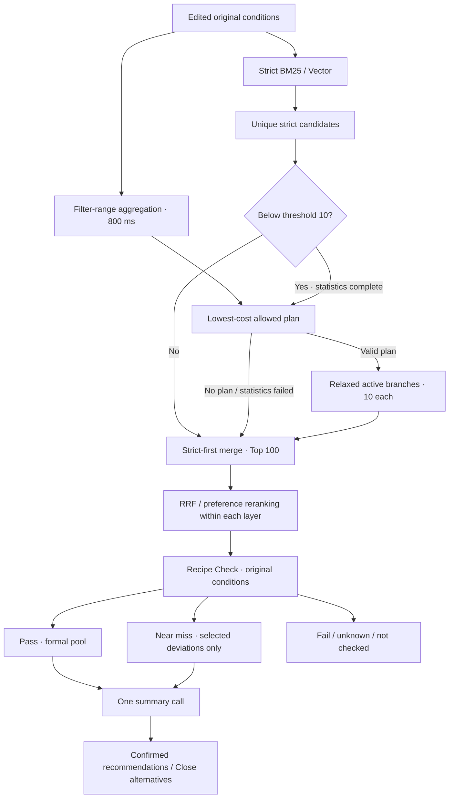

# Retrieval flow: unified recall relaxation and final eligibility

This is the current execution contract (introduced in 1.2). Multi-direction relaxation, added in 1.3, is described in [multi-relaxation.md](multi-relaxation.md).

## Recall contract

- All active branches start with identical original ES filters. Category hard conditions remain semantic work; required AND/OR retains safe ES projection. Manual Labels and exclusions never relax.
- Statistics count complete named filter variants without content query. They do not predict actual lexical/vector recall. Missing numerical fields are counted under original non-numeric filters, but never prove final eligibility.
- Defaults: strict threshold 10, relaxed branch depth 10, near-miss target 5; maximum two modified condition groups. Old `bm25_fallback_threshold` is a request alias only; conflicting new/old values are rejected.
- Protect explicitly core ingredients and meaningful ingredients in dish-name targets in groups. A sole required specific ingredient has the explicit exception below. Do not infer core status from a generated query. Ordinary removal applies only to non-core specific leaves directly inside top-level AND. OR/complex subtrees remain intact.
- Upper bounds multiply by 1.2 / 1.5; lower bounds divide by those factors; whole field intervals change together without rounding. Equality is not relaxed. Cost order: numeric 20%, remove non-core leaf, numeric 50%, remove numeric constraint. Single-condition plans precede pairs; tie-break by cost, change ratio, sufficient count and stable construction order.
- Pick only a plan that increases strict filter matches and reaches the range target. Statistics timeout/failure/incomplete buckets do not trigger blind fallback. Strict retrieval remains usable even when supplemental branches fail.
- Reuse the Vector embedding from strict recall. Original query texts and boosts do not change. Strict and relaxed layers fuse/rerank separately, deduplicate IDs, preserve strict priority and retain at most 100. Branch source and layer provenance remain separate.

## Check and Generation contract

- Original edited conditions, source fingerprints, chosen relaxation actions and candidate provenance are part of the execution/cache snapshot. Client-supplied actions must belong to a legal plan; recall actions never change formal eligibility, including the sole-required exception.
- Near miss requires a definite violation of selected relaxed conditions and pass on every other applicable hard condition, including the original required expression with only selected relaxed atoms provisionally waived. Exception: a completed model dish-name identity judgment of unknown may be shown as an explicit additional near-miss deviation for relaxed-source candidates only; all other applicable conditions must pass after accounting for selected recall deviations. Strict candidates retain unknown status. Pending model checks never qualify for this exception.
- Check strict candidates before relaxed candidates; stop at the existing formal-pool target or, when not reached, at five checked near misses once outstanding strict semantic work is complete. Existing Top 100 remains the only pool.
- Check candidates and Generate stay independent. Local checks cost no model call; necessary semantic batches use the selected check model and existing concurrency, partial-result retention and explicit retries.
- Summary receives separate pass/near_miss ID groups and explicit deviations. Formal recommendations reference only pass; close_alternatives only near_miss, at most five. Source ingredient names, quantities and steps are never rewritten. With no usable pool, no summary model is invoked.
- Extraction schema v8 adds ingredient.core (legacy snapshots default false). JEV remains a limited legacy adapter. Generation schema v11 retains near_miss counts, near_miss_recipe_ids and close_alternatives to the existing split interfaces.

## Inspection and validation

The shared Relaxation decision node opens the original/protected conditions, full plan counts, costs, selected reason, actual branch counts, snapshots and copyable statistics DSL. Statistics are labeled filter-range counts, never recall counts. Check adds a near-miss group; Generation places Close alternatives after formal recommendations with visible deviations.

Tests use simulated ES and four provider responses. Real-model latency/quality/cost and real-index selectivity require separate measurements with credentials and the updated server. No historical experiment records or indices are changed. No fixed latency gain is promised.

## Sole-core ingredient exception (2026-10-24)

A single required specific ingredient, including core durian in `fruit Salad with durian`, may be removed in a single-action recall plan when strict recall is below the threshold and statistics show a sufficient increase. Both active branches remove its include value and the single required-expression leaf. Category requirements, OR/AND groups and all other protected constraints retain their previous policy; this exception is never combined with a second relaxation action.

The sole-required exception is recall-only and is available only when that ingredient is the sole positive ES hard-filter condition; exclusions remain protected and do not prevent this exception. Dish name and dish type do not count as ES hard filters. Numeric conditions, manual Labels and category requirements prevent this special single-condition exception. All candidates retain the original required expression in Recipe Check. Missing dropped ingredients supported by a nonempty recorded list can be assessed locally; unresolved mixtures, aliases and extracted usage stay semantic work. Only definite deviations with every other condition passing enter near_miss. No relaxed candidate becomes formally qualified by dropping a requirement.

Ingredient interpretation rows and Check details expose Core: yes/no. The editable core list explains this exception. The flow preserves strict branch times and counts, and adds separate relaxed BM25/Vector time nodes followed by returned/new count nodes. The page uses left-to-right stage cards on desktop, with parallel BM25/Vector branches stacked inside each retrieval card and forward split/merge connectors. Narrow screens use vertical stage cards. A decision without executed relaxation connects directly to merge/RRF. The top-left heading toggles diagram visibility without affecting execution. Cards and branch nodes mount only on actual execution events; future stages and unused branches are absent from the live DOM. Strict-sufficient runs omit the relaxation card entirely. Original/relaxed branch counts arrive with their completed progress events, followed by merge and RRF progress. This presentation does not change the parallel architecture above.

## Live progress presentation

The browser reuses the existing search event stream. Strict branch completion includes `candidate_count`; supplemental completion also includes `added`. `candidate_merge` reports the deduplicated pool; RRF completion includes its retained candidate count. These are server-reported counts/timings, not browser estimates. While final response assembly is pending, the output step may show the known fused count with a preparation spinner. A final snapshot resolves all current statuses. Early statistics events are buffered until the strict candidate check has been reached. No artificial delay or paid/model/retrieval retry is added. All ranking and eligibility rules are unchanged.

## Semantic evidence isolation

Dish name and dish type checks both receive recorded instructions and may quote complete recorded instruction entries. Invalid or missing required evidence downgrades only the affected check to unknown with a warning and preserved raw evidence; it does not fail a whole batch. Exclusion absence defaults never override this validation unknown. Strict candidates remain unconfirmed. Relaxed candidates may expose an unknown dish identity as an explicit near-miss deviation if all other applicable conditions pass; ingredient/category validation unknowns remain unconfirmed. Unknown IDs, duplicate/missing checks and immutable local-decision violations remain structural failures.

## Identity evidence continuity

Generation rechecks include previous semantic decisions and their verified quotes. Complete previously cited instruction entries are passed as identity_instruction_evidence; the full instruction list stays out of summary context. This avoids withholding the exact evidence that justified Check qualification. Recheck removals expose condition-specific warnings and an explicit empty-result explanation.

## Default authority boundary

Recipe Check owns semantic eligibility. SummaryRequest and legacy generation wrappers default recheck=false. Generation receives prior checks and verified evidence for explanations, but no pending semantic checks; cached qualification is not recomputed or changed. Known redundant semantic decisions from a summary response are ignored. Group membership, ID uniqueness, complete output coverage and source validation remain mandatory. Explicit research opt-in preserves the existing recheck experiment and overturn statistics.
