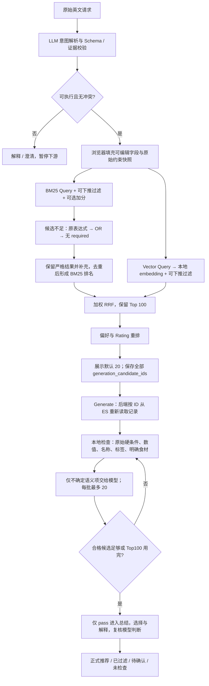

# Recipe Search Lab — Prototype 1.2 架构评审材料

日期：2026-10-21。用途：向另一个模型或研究者提供自包含上下文，获取宏观架构、检索策略、约束执行、延迟与评估设计方面的建议。

## 请评审者如何回答

请将自己视为检索系统与 LLM 应用架构评审者。先复述你理解的系统目标，再指出最重要的架构问题。请区分：确定存在的问题、需要实验验证的假设、以及可选优化。不要将本文描述的产品规则当作已证实的模型能力。

请重点检查：

1. 原始要求、召回计划和最终推荐资格的分离是否合理，有没有约束丢失或重复判断。
2. BM25／Vector Query、硬标签范围、多级降级及 RRF／偏好重排是否存在相互抵消或候选覆盖问题。
3. 本地规则＋按需语义检查＋总结的划分，是否能在当前原型约束下进一步减少延迟和费用。
4. 当前系统是否足以支撑一项清晰的论文实验；最少需要哪些 baseline、消融与指标。
5. 请给出 P0／P1／后续研究建议，每项说明问题、修改位置、收益、风险、实施成本和验证办法。优先推荐能在 1–2 周内完成的小范围改造。

请不要默认引入微服务、分布式队列、独立向量数据库、复杂 Agent 或新增意图；如认为必要，请给出当前架构无法解决的具体证据。不要直接开始写代码。

---

## 1. 项目目标、范围和实施状态

这是用于毕业论文研究及向导师演示的食谱搜索原型，不是生产级饮食咨询服务。主要场景是英文自然语言 recipe search，展示用户要求如何被解析、转换为召回与排序条件，再从已有食谱中选择并解释推荐。

近期交付：2026 年 11 月底初步项目演示及阶段汇报。重点为 recipe search、意图与约束、检索／排序／推荐解释、可观测性。Meal planning、多轮指代、单菜问答、替代食材不在近期必需范围。

**状态口径：** 本材料基于 2026-10-21 实际工作区代码。该工作区已包含 recipe-extraction-v5／recipe-generation-v5：分组 AND／OR、多级 required 降级、统一最终资格及自适应检查均已有实现，不只是拟议方案。旧 README 和旧架构段落中仍有追加式文档，可能描述 v4 行为；与本文冲突时需核对实现。代码存在不代表运行中的旧服务已经加载新版本。

本次重新运行 Python 回归为 **162 项通过**。验证记录另包含 Node 逻辑检查和模拟浏览器回归。它们主要使用模拟 ES／模型响应，不能证明真实模型准确率、真实检索质量或端到端性能收益。已有历史真实案例用于开发调试；尚未形成冻结的当前版本全链路 benchmark。

## 2. 技术与数据基础

- 前端：原生 HTML、CSS、JavaScript；三阶段界面，用户显式触发每一步。
- 后端：Python、FastAPI、Pydantic、Uvicorn，本地单服务默认端口 8002。
- 检索：现有 Elasticsearch 索引，同时包含文本／keyword 字段和 content_vector。
- 向量：本地 Sentence Transformers 加载 BAAI/bge-base-en-v1.5；查询添加模型约定前缀，归一化后执行 ES kNN。
- 模型：GPT-4.1 mini、GPT-4.1 nano、Astra 路由及 DeepSeek Flash；OpenAI 与 DeepSeek 使用各自直接 API，JEV 保留旧适配，能力不等同于生成式解析器。
- 数据：recipe ID、name、description、ingredients、keywords、recipecategory、时间、营养、评分及 instructions。词形兼容表来源于约 522,517 条本地 parquet 数据；这不是本次测量的 ES 实时文档数或字段完整率。
- 尚不能假设标签齐全、食材列表完整、营养零值可信或营养口径已被逐条验证。现在沿用营养按份的原型约定，未确认口径的解析数值不能自动应用。

## 3. 总体信息流



图中循环是对现有候选继续检查，不重新检索。没有合格项则不调用总结模型。单路模式不执行 RRF。BM25 降级可以跳过等价阶段，且受总时限约束。

## 4. 产品语义：什么算正确

### 4.1 食材、组合与不确定性

每个解析食材含 name、entity_type（specific/category）、role（available/required/excluded/prefer/avoid）、evidence；证据必须能对应原文，支持拼写纠正。

- available 是已有食材，偏好其出现，不要求全部或任一必须出现。
- prefer 提高排名，avoid 降低排名；不是硬条件。
- no／without／过敏／hate 等强烈厌恶为 excluded；普通 dislike 为 avoid。规则是语义定义，不要求穷举所有英语表达，也不保证模型完全正确。
- “less salt”等减少用量要求放入 generation_notes，只能解释，不能改写食谱、凭空给剂量或宣称原食谱已满足。
- chicken broth 可满足 required chicken；excluded onion 包括 onion 变体、粉末及明确含 onion 的混合制品。不明复合成分为 unknown。
- 类别按烹饪语境判断，并尊重例外，例如“允许 vegetable broth，但不要 vegetable pieces”。不将其简化为排除所有 vegetable。

required_expression 是树：叶节点引用本次 required 食材，内部节点为 AND 或 OR，允许嵌套；限制深度和节点数并校验引用。例：

```json
{
  "op": "AND",
  "ingredient": null,
  "children": [
    {"op":"OR","ingredient":null,"children":[
      {"op":"ingredient","ingredient":"beef","children":[]},
      {"op":"ingredient","ingredient":"chicken","children":[]}
    ]},
    {"op":"ingredient","ingredient":"potato","children":[]}
  ]
}
```

缺少表达式的旧接口沿用 include 至少一个的 OR 行为，不能把显式 AND 当成 OR。

AND：任一 fail 则 fail；全部 pass 才 pass；其余 unknown。OR：任一 pass 即 pass；全部 fail 才 fail；其余 unknown。一个 OR 分支已满足时，另一个分支不应导致整体错误失败。

### 4.2 菜品、范围和时间

- 明确 Dish name 是硬目标：规范化名称包含该完整短语，允许前后修饰；不是任意语义相似即可。
- 只有 Dish type 时，标签或名称明确命中可满足；无明确证据时语义检查，不能按 Vector 分数直接认定满足。stew 可能被召回，但不是保证召回，更不是自动满足 soup。
- 无 Dish name／Dish type、但有直接要求的 Meal／Cuisine 时进入硬标签范围；“Find an Italian lunch”要求两者。“I prefer Italian flavors. Any lunch ideas?”只将 lunch 设为硬范围。
- 标签缺失表示缺少证据，不能证明菜品语义不符合；但硬范围检索仍会排除缺标签记录，是已知覆盖风险。
- 15-minute → 总时间 ≤15；around 30 → ≤30；quick/fast 是总时间 ≤30 的软加分。“quick but under 45”是 <45 硬上限加独立 quick 加分。
- 显式数值保留 <、≤、>、≥、=，单位统一。矛盾范围要求澄清。缺失营养/时间不能当满足。

### 4.3 推荐底线

**允许放松召回条件，不允许放松正式推荐资格。** 原始条件来自用户最后确认/编辑的快照，不是某次放松后的 DSL。

pass 可进入正式推荐；fail 只进入过滤区；unknown 单独展示；not_checked 表示未检查，不冒充 unknown 或 pass。用户要求 5 道但只有 2 道合格就返回 2 道。没有合格项是正常空结果，不虚构、不静默放松、不自动追加检索。

## 5. 当前检索实现

### 5.1 两路 Query 的生成

目前两路接口独立，但**自动生成策略仍基本共用**：

1. Dish name 存在时优先用 Dish name。
2. 否则 Dish type 存在时拼接必需的具体食材＋Dish type；表达式中的 OR 备选不全部强塞进 Query。
3. 否则使用正向 Search description，最后兜底原输入。
4. 前端正则移除 no／without 等否定片段。
5. 自动填入 BM25 query 和 Vector semantic query；两框后续可独立编辑。后端保留旧 query-only API 兼容。

否定清理是启发式规则，仅作用于自动填值，不是完备英语语义分析。当前没有两套成熟的专用 Query 生成器，也不额外调用 LLM 重写两路 Query。

### 5.2 BM25 与 Vector

Content search：BM25 multi_match 使用 name^5、keywords^3、ingredients^2、description^2、searchable_text；best_fields、无模糊匹配、minimum_should_match 为 2<75%。

BM25 可选 constant_score 加分：菜名 name match_phrase +12、Dish type 标签 +5、Cuisine 标签 +2、required 具体食材 +2、正向类别 keywords +2。Available 在 Label scope 下默认每组 +2。外层 should 不决定基础资格，但加分会改变 Top-N 的候选成员。

Label scope：BM25 跳过内容 multi_match，在标签范围内 match_all＋可选加分；Vector 仍使用独立语义文本做 embedding，并受同一范围过滤。范围内同组标签 OR，不同 Meal／Cuisine 组 AND。

具体食材过滤仍以 ES keyword 数组的大小写兼容 substring/wildcard 为主；部分 BM25 加分使用词形备选＋字段词表。它们并非完整食材本体或语义映射。最终资格检查使用比 ES 原始 substring 更明确的词语/短语与语义逻辑；两层可能存在覆盖差异。

required 表达式只做安全下推。类别叶子无法直接编译成具体食材过滤：category OR specific 不能被错误收紧成只允许 specific；AND 中能够独立确定的具体部分可以下推。

### 5.3 降级、执行与融合

- BM25 不足默认 5 条时：原表达式 → 所有 required 的 OR → 移除 required。只放松 required，不移除 excluded、数值、手动标签和硬范围；本轮不增加菜品目标降级。
- 保留严格结果，按降级层次追加，recipe ID 去重，达到分支候选上限截取；跨 DSL 不直接比较原始 ES 分数。
- Vector 不新增降级。每层保存条件、实际请求、耗时、返回/新增候选数、是否使用和停止原因。
- Hybrid 默认并行，保留串行作比较。ThreadPoolExecutor 4 workers，进程内 admission 上限 8；分支默认时限 30 秒，无自动 ES 请求重试。
- Python 无法强制终止正在执行的 embedding/网络任务；超时结果不采用，但底层任务可能稍后完成。这不是分布式任务系统。
- 默认每路 1000，配置上限 2000。单路失败可以降级返回存活分支，明确标识；两路失败报错。

加权 RRF：

```text
RRF(d) = bm25_boost / (k + rank_bm25)
       + vector_boost / (k + rank_vector)
```

rank 从 1 开始；缺失路贡献 0；按 recipe ID 去重，稳定排序。API 默认 k=10、BM25 boost=1、Vector boost=2。

先 RRF 截取 Top 100，再偏好重排：

```text
Normalized RRF = RRF / ((bm25_boost + vector_boost) / (k + 1))
Final = Normalized RRF + λ × Preference Score + Rating bonus
```

λ 默认 0.30；正向偏好按启用组权重归一化，avoid 产生负贡献。评分 5/4/3 的 bonus 系数分别为 1/0.8/0.6，其余 0，乘配置 rating_boost。健康、quick、easy 使用实验规则；不能把 healthy 分数当成医学健康结论。

Results 默认展示 20、上限 50；另返回按偏好重排后的 generation_candidate_ids，最多来自已保留的 Top 100。偏好重排无法挽回 RRF Top 100 之外的食谱。

## 6. 最终资格与推荐生成实现

### 6.1 输入可信来源

Generate 请求携带原请求、解析快照、实际检索参数快照、候选 ID 和降级记录。后端不接受客户端提供的食谱正文作为事实，而是按 ID 从 ES mget 读取。

这保证正文取自存储，但目前不等于有服务端不可伪造的检索凭证，也不保证检索和生成之间索引未更新。原型以本地受控交互为主要场景。

### 6.2 本地先判，再处理不确定语义

从有效快照建立统一 hard conditions：required expression、excluded、类别、数值、标签、Dish name／Dish type。

- 数值直接比较；缺失值 unknown，不请模型猜测。
- 名称短语按规范化字面规则判断。
- 标签精确证据可通过；缺失 unknown，不由模型填补标签事实。
- 明确食材短语命中可判断；具体食材未命中通常仍为 unknown，因为别名/复合制品可能隐藏成分。
- 类别和无明确证据的 Dish type 交语义检查。
- 明确本地失败的候选可以直接排除，不为其额外请求语义判断。

**重要成本特征：** 当前本地食材判断偏保守。“没有命中 excluded onion”并不直接证明不含 onion，因此仅有具体排除的请求也可能产生语义模型调用；不能声称只有类别条件才调用模型。

模型只处理 pending checks，返回 matched/not_matched/unknown、完整原字段证据与理由。后端校验 ID 完整覆盖、唯一性、条件顺序和证据，不允许模型改写已确定的本地判断。模型证据必须对应完整的允许字段；校验通过只说明结构和证据引用有效，不证明语义结论正确或数据完整。

### 6.3 自适应批次与总结

按候选顺序每批最多 20，先本地检查，再仅发送存在 pending 项的食谱。语义输入含 ID、名称、完整食材、关键词/分类和待判断条件，不含向量或图片。

合格候选目标为 max(20, 用户请求数量)，上限 50；默认请求推荐 5，道数目标仍保留 20 个合格候选供总结选择。达到目标即停止，否则最多检查 Top 100。批次结束后判断，所以最后一批可能带来超过目标的 pass；总结池按排名截取目标数量。剩余标记 not_checked。

没有 pass 时不调用总结。否则总结模型仅从合格 ID 中选择、排序、解释；输入保留原条件和资格依据，复核已经由模型参与的语义项。复核后的 fail/unknown 不能正式推荐；减少后不自动再检查后续批次补足。

食材与 instructions 在页面来自源记录；总结模型不接收完整做法，不得生成或改写做法、剂量和食材。模型提供英文 summary、reason、flavor、best_for，不生成食谱正文。

### 6.4 预算、错误和并发

- 每个 provider 调用 60 秒超时，不自动重试付费调用；进程内最多两轮生成并发。
- 浏览器总体等待上限 420 秒。批次逐个执行，当前付费调用无法立即被浏览器撤回；断开后阻止后续调用。
- 本地每次 payload 保护上限为 120,000 **字符**，不是实测 Token 上限，也不是 provider 的模型上下文大小。
- 总结超限时优先移除靠后的完整候选，不截断食材；单次语义批次仍超限时停止、保存准备提交的模型请求，不进行付费调用。
- 输入输出、模型/提示词 hash/Schema 版本、后端耗时、usage、估算费用和失败阶段可观察。费用估计不是账单；缓存用量依据 provider 返回。
- 模型无效结构或证据失败不显示为成功推荐；部分批次失败保留诊断，不把不完整流程当成功结果。

## 7. 接口与状态边界

主要接口：

- POST /intent/parse/{model_key}：解析、校验、澄清、usage 与版本。
- POST /recipes/search 或 /api/search；/api/search/stream 返回进度：独立 Query、原始分组与类别、过滤/范围/偏好、降级层次、分路状态、实际 DSL、候选/融合数量、generation_candidate_ids。
- POST /content/generate/{model_key}，支持 stream：原请求、快照、ID；返回推荐、所有候选状态、依据、批次与停止原因、usage/费用及诊断。
- GET /recipes/{id}：源食谱详情；实时读取失败时可以明确标识并展示本轮已保存的对应记录，不能用其他食谱兜底。

前端三个阶段可往返检查。解析结果自动填值后可手动编辑；上游改变使下游失效，修订号和 AbortController 阻止旧响应覆盖。关键按钮区分执行与下一步。技术细节默认折叠，检索优先展示流程图，生成优先展示推荐正文。

## 8. 已知风险与希望重点得到的优化建议

1. **过滤覆盖与语义一致性。** ES substring、词形词表、本地短语和模型语义不是同一个匹配器。严格 ES 排除可能提前损失候选；只在 Generate 检查也无法找回已经排除的数据。如何保持执行标准一致，又不建立庞大食材本体？
2. **标签范围。** 稀疏标签可能把相关食谱排除；缺标签又不应该被断言为不符合。是否应保留硬语义要求，但用更宽的召回和不同最终证据策略？这属于修改当前产品执行方式，不能静默实施。
3. **菜名短语限制。** 容易验证，但会拒绝同义名、别名或词序变化；与 Vector 的语义召回能力可能抵消。如何测量其收益与损失？
4. **Query 构建位置与否定清理。** Query 自动生成仍在前端，主要共用规则，正则否定移除可能误删信息。是否值得引入后端版本化 Query/Constraint Plan，怎样避免额外 LLM 调用？
5. **降级触发与合并。** 当前阈值是 BM25 原始数量，不是最终合格数量；严格层优先合并相当于引入额外排名先验。如何与 RRF 公平比较？是否需要区分召回不足与资格不足？
6. **候选级联。** 每路 1000 → RRF 100 → 偏好重排 → 合格总结池 20–50。排序阶段不可挽回之前丢失的候选，候选扩大也不保证相关性改善。
7. **实际延迟。** embedding、ES、语义检查和总结各有成本。即使不跑满 Top100，排除/unknown 很多时仍可能五批；同一轮总结复核又会重复部分语义工作。哪些判断可缓存、复用或改变输出职责？缓存键和数据/模型版本如何设计？
8. **吞吐与取消。** 同步 provider HTTP、线程池、进程内限流适合当前本地演示，但不能保证多用户扩展；不要为了理论扩展过早改成分布式架构。
9. **上下文预算。** 字符上限、完整食材和重复条件/证据之间的成本权衡；是否需要按模型 Token 预算与结构化最小输入重新设计？不能截断导致错误资格判断。
10. **评估与论文主线。** 是否应聚焦约束忠实性、检索相关性、还是延迟/成本？如何避免同时改变 Query、候选、过滤、排名、模型导致无法归因？

可能的研究问题：

- 自然语言结构能否正确区分并映射硬条件、软偏好、类别与分组？
- Hybrid 和偏好重排是否优于单路或纯 RRF？
- 本地规则＋模型语义检查是否减少最终约束违反，代价是多少？

建议先固定开发集和独立测试集，比较 BM25、Vector、纯 RRF、RRF＋偏好重排，另做语义检查前后对照。记录相关性、硬条件违反、unknown/未检查、空结果、延迟和费用。无全库相关性真值时不要将标注池覆盖称为全库 Recall。

## 9. 希望评审最终交付的格式

请提供：

1. 对当前架构的简短判断及最重要的三个问题。
2. 一张建议的信息流图，明确哪些模块保留、合并或拆分。
3. 优化表：优先级／建议／解决的问题／收益／风险／工作量／验证指标。
4. 一套 1–2 周可落地的最小修改方案，以及可暂缓事项。
5. 对当前产品规则中可能互相冲突或不可验证的部分提出具体问题，举例说明；不要暗中改变规则。
6. 区分“代码修复”“研究假设”“需要人工标注/实测”的建议；不要给没有测量依据的准确率或提速数字。

附：可供代码评审定位的主要模块为 recipe_search_api.py、retrieval_execution.py、rrf.py、preference_ranking.py、constraint_logic.py、eligibility.py、content_generation.py，以及 web 下的 intent-ui.js、workflow.js、retrieval-flow.js。本文不含 API Key、ES 密码或连接凭据。
