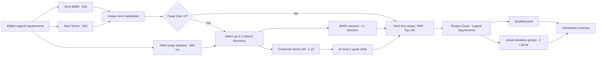

# Prototype 1.3 — Multi-direction recall relaxation

Baseline: independent copy of Prototype 1.2. Default service: http://127.0.0.1:8003.

## Execution and information flow

Statistics count only filter-range matches, never text relevance or actual returned recipes. A plan must increase the strict range and meet the configurable per-plan minimum (default 3). Greedy selection sorts singles before pairs, then cost, proportional change, count and stable order. Selected directions cannot overlap. Pairs are considered only if fewer than two single directions were selected. Maximum three.

Existing ingredient protection, sole-core recall exception, AND/OR restrictions, exclusion/manual-label preservation, exact numeric operators, missing/zero time handling and original qualification remain active. v1 remains selectable through `relaxation_strategy=single`; multi is the new default. No ES reindex or data rewrite.

## Bounded recall

BM25 uses one `_msearch` with one independent query per plan. Vector normally sends one `_msearch` envelope containing one combined OR-filtered kNN query. Small plans (filter count ≤20) are direct filter subqueries in that same envelope, with no kNN or semantic similarity claim. This packaging also allows mixed small/large plans without an extra network request. Each subquery retains its own execution status.

Vector attribution evaluates only the exact deterministic keyword/range filter DSL used for recall. It is not semantic qualification. The query vector is read from strict retrieval; it is never encoded again. If unavailable, that part fails explicitly. Up to two underfilled large directions can be refilled. All calls share one 1.5-second relaxation deadline and process-wide admission bounds. Completed subresponses are retained; late responses cannot change a returned snapshot. A request timeout cannot forcibly cancel server-side ES work.

Small direct-fetch responses retain all fetched counts in execution records; branch candidate lists retain at most the per-direction quota, exclude already-kept strict IDs, and merge duplicate IDs with every source plan. Direct-fetch order is deterministic `_doc`, not vector similarity. Strict candidates precede relaxed candidates throughout ranking.

## Check and generation

Metadata retains `source_plans`, planner actions and original snapshots. Near-miss grouping uses actual failed condition IDs/names, never a source-plan label. Identity uncertainty keeps the existing conservative exception for checked relaxed candidates. Unrelaxed failures remain ineligible; unresolved necessary checks remain unconfirmed/not_checked.

Qualified-prefix target remains 20 (up to 50 for larger requests). Otherwise semantic checking stops when observed groups meet the quota or their candidate direction is exhausted. All necessary strict-layer checks precede this stop. No extra retrieval is added after checking. Generation receives only checked qualified and near-miss pools, up to three actual-deviation groups with two selected recipes each by default. Source ingredients/instructions are unchanged. Model group summaries reference validated group keys; formal recommendations can only reference pass recipes.

UI: flow stays above the list with parallel BM25/Vector and progressive events. The decision node lists directions; its icon opens filter counts, actual per-direction retained counts, timings, failures and full copied JSON/DSL. Generated alternatives appear in separate titled tradeoff sections, with per-recipe deviation notes and a final comparison table. Technical diagnostics stay folded.

## Configuration and experiments

`relaxation_max_plans=3`, `relaxation_plan_min_matches=3`, `relaxed_bm25_per_plan=5`, `relaxed_vector_k=15`, `relaxed_vector_num_candidates=100`, `near_miss_per_group=2`, `relaxation_small_plan_threshold=20`, `relaxation_timeout_seconds=1.5`.

Research comparison: `relaxation_vector_strategy=separate` uses independent Vector subqueries in one msearch; default `combined` uses one OR-filtered query plus bounded refills. The benchmark script compares single / multi-separate / multi-combined on saved requests. Retrieval-only metrics do not establish semantic diversity, qualification accuracy or paid model costs. Real ES/model timing, 20–30-query evaluation and human preference judgments remain separate empirical acceptance work; no speedup is claimed from simulated tests.
